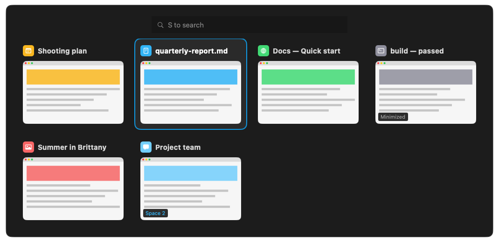

# mTAB

A window switcher for macOS: every window of every app, with live previews, search and up to nine configurable shortcuts.

## About

mTAB is made by Starbudweiser & Claude Code (Anthropic). Part of the **DESKTOP MAC TOOLKIT**. MIT License, © 2026 Starbudweiser. Provided as is, without warranty. "About mTAB" is in the app menu.

mTAB is inspired by AltTab and is not affiliated with its authors.



## What it does

Hold a shortcut (by default ⌘⇥) and mTAB shows a switcher with all open windows, not just one entry per app. Pick a window with the keyboard, the mouse or a trackpad swipe, and release to bring it to the front. By default mTAB replaces the system ⌘⇥ switcher and disables it while it is in use; the system shortcuts are restored when you remove the shortcut or quit.

## Features

- Up to 9 shortcuts, each with its own keys and filters: all apps or active app only, all Spaces or current Space, all screens or current screen, show or hide minimized windows and hidden apps. Defaults: ⌘⇥ (all windows) and ⌘ + the key above Tab (windows of the active app).
- Three styles: thumbnails, app icons or titles; small, medium, large or automatic size; dark, light or system theme; optional full-size preview of the selected window.
- Search: type part of a window title or an app name to filter.
- Actions on the selected window while the switcher is open: close, minimize, full screen, quit or hide the app.
- Badges for minimized, hidden, full-screen windows and the Space number.
- Choice of behavior when the keys are released (switch to the window, or keep the switcher open).
- Optional three-finger trackpad swipe to switch windows.
- Per-app exceptions: hide an app's windows, or ignore the shortcuts while that app is frontmost (useful for virtual machines and remote desktops). Several are preconfigured.
- Menu bar icon, Dock icon or both; launch at login; optional install as a launchd user agent that restarts after an unexpected stop.
- Command line: `mtab --list` prints the windows as JSON, `mtab --focus <id>` activates one (an install command is available in Settings).
- Interface in French, English, Spanish and Italian, chosen from the system language (English otherwise).
- Automatic updates from this repository's releases (signature checked), with a manual check button in Settings.

## Requirements

- macOS 14 (Sonoma) or later, Apple Silicon.
- Accessibility permission (to capture shortcuts and act on windows) and Screen Recording permission (for window previews). mTAB sends nothing off your Mac.

## Installation

1. Download `mTAB-<version>-macOS.zip` from the [Releases](https://github.com/starbudweiser/mTAB/releases) page.
2. Unzip it and move `mTAB.app` to your Applications folder.
3. Open it and grant the two permissions in System Settings > Privacy & Security.

The app is signed with a Developer ID and notarized by Apple.

## Build from source

```sh
swiftc -O -swift-version 5 -parse-as-library -target arm64-apple-macos14 \
  -F /System/Library/PrivateFrameworks -framework SkyLight -o mTAB Sources/*.swift
```

`build.sh` builds the app bundles and signs them with a local certificate. mTAB is written in Swift (AppKit and SwiftUI) with no external dependency; it uses the private SkyLight framework to list windows and Spaces.

## License

MIT, see [LICENSE](LICENSE).

---

# mTAB (français)

Sélecteur de fenêtres pour macOS : toutes les fenêtres de toutes les applis, aperçus, recherche et jusqu'à neuf raccourcis configurables.

mTAB est réalisé par Starbudweiser & Claude Code (Anthropic) et fait partie du **DESKTOP MAC TOOLKIT**. Licence MIT, © 2026 Starbudweiser. Fourni en l'état, sans garantie.

Fonctions : raccourcis multiples avec filtres (applis, Spaces, écrans, fenêtres réduites ou masquées), styles vignettes / icônes / titres, recherche, actions sur la fenêtre sélectionnée (fermer, réduire, plein écran, quitter, masquer), balayage à trois doigts, exceptions par appli, icône de barre de menus ou Dock, lancement à l'ouverture de session, ligne de commande (`mtab --list`, `mtab --focus <id>`), interface en 4 langues et mise à jour automatique.

Configuration requise : macOS 14 ou plus récent, Apple Silicon ; autorisations Accessibilité et Enregistrement de l'écran. Installation : télécharger le zip depuis la page [Releases](https://github.com/starbudweiser/mTAB/releases), déplacer `mTAB.app` dans Applications. Application signée et notarisée.
